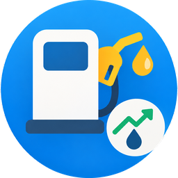

<p align="center"></p>

# Carburants — Home Assistant

Intégration personnalisée Home Assistant qui récupère les prix  des carburants autour de votre ville et vous indique la **station la moins
chère** dans le rayon de votre choix, directement dans des capteurs.

## Indicateurs fournis

Un appareil est créé par combinaison ville / carburant / rayon, avec les entités suivantes :

| Entité | Description |
|---|---|
| `sensor.<nom>_prix_le_plus_bas` | Prix de la station la moins chère de la zone (€/L) |
| `sensor.<nom>_station_la_moins_chere` | Nom de cette station |
| `sensor.<nom>_distance_de_la_station` | Distance de cette station (km) |
| `sensor.<nom>_prix_moyen_de_la_zone` | Prix moyen des stations de la zone (€/L) |
| `sensor.<nom>_stations_dans_la_zone` | Nombre de stations avec un prix dans la zone |

Le capteur **Prix le plus bas** porte aussi en attributs :

| Attribut | Description |
|---|---|
| `station` | Nom de la station la moins chère |
| `distance_km` | Distance depuis le centre de la ville |
| `verification` | État affiché  (« Vérifié aujourd'hui », « Vigilance prix »…) |
| `rayon_km` | Rayon configuré |
| `classement` | Les 10 stations les moins chères de la zone (station, prix, distance, vérification) |

Carburants disponibles : **Gazole, SP95-E10, SP95, SP98, E85, GPL**.

Les capteurs de prix ont `state_class: measurement` : ils alimentent les statistiques de
Home Assistant et sont utilisables dans des cartes historiques.

## Installation

### Via HACS (dépôt personnalisé)

[](https://my.home-assistant.io/redirect/hacs_repository/?owner=maximeblanchard&repository=ha-carburants&category=integration)

Le bouton ouvre directement votre instance Home Assistant sur la boîte de dialogue HACS.

Sans le bouton, manuellement :
1. HACS → menu ⋮ → "Dépôts personnalisés"
2. Ajouter l'URL de ce dépôt GitHub, catégorie "Intégration"
3. Installer "Carburants", redémarrer Home Assistant

### Manuelle
1. Copier le dossier `custom_components/ha_carburants` dans `config/custom_components/`
2. Redémarrer Home Assistant

## Configuration

Paramètres → Appareils et services → Ajouter une intégration → "Carburants"

[](https://my.home-assistant.io/redirect/config_flow_start/?domain=ha_carburants)

- **Ville** : le nom de la ville (ex. `Paris`)
- **Carburant** : le carburant à suivre
- **Rayon de recherche (km)** : de 1 à 50 km, 10 par défaut

La configuration est refusée si aucune station avec un prix n'est trouvée dans le rayon.
Pour suivre un autre carburant, une autre ville ou un autre rayon, ajoutez simplement une
nouvelle entrée de l'intégration.

## Fonctionnement

- La station la moins chère est la première après tri par prix, puis par distance.
- Les stations en pénurie ou indisponibles (sans prix) sont ignorées.
- Si aucune station n'a de prix dans la zone, les capteurs deviennent sans valeur jusqu'à la
  prochaine actualisation réussie.
- Actualisation toutes les 30 minutes. Forcer une mise à jour : action
  `homeassistant.update_entity` sur un capteur Carburants.

### Exemple d'automatisation

```yaml
automation:
  - alias: "Carburant : prix bas"
    trigger:
      - platform: numeric_state
        entity_id: sensor.carburant_sp95_e10_paris_10_km_prix_le_plus_bas
        below: 1.95
    action:
      - service: notify.notify
        data:
          title: "Carburant pas cher"
          message: >
            {{ states('sensor.carburant_sp95_e10_paris_10_km_station_la_moins_chere') }}
            à {{ states('sensor.carburant_sp95_e10_paris_10_km_prix_le_plus_bas') }} €/L
```

## Notes

- **Le rayon est mesuré par  depuis le centre de la ville**, pas depuis votre domicile.
  Choisissez un rayon un peu plus large si vous habitez en périphérie.
- Les prix de plusieurs stations d'une même enseigne peuvent être identiques (prix plafonnés
  ou alignés) : ce n'est pas un défaut de lecture.


## Dépannage

Pour obtenir des logs détaillés, ajoutez dans `configuration.yaml` :

```yaml
logger:
  logs:
    custom_components.ha_carburants: debug
```

- **Aucune station dans ce rayon** : augmentez la distance, ou vérifiez que ce carburant est
  vendu dans la zone.

- **Capteurs indisponibles** : le site a répondu en erreur, les valeurs reviennent à la
  prochaine actualisation réussie.

## Licence

MIT
